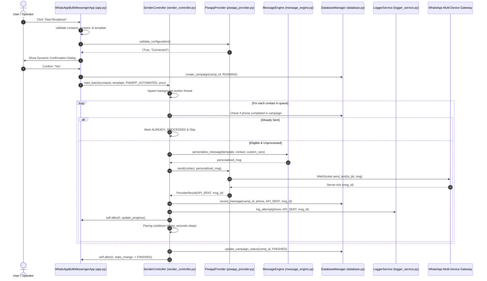

# WhatsApp Bulk Messenger — Full Project Reverse Engineering & Technical Audit Report

**Date of Audit:** November 2, 2026  
**Auditor:** Senior Software Architect, QA Engineer & Security Auditor  
**Project:** WhatsApp Bulk Messenger v1.0.0  
**Target Repository:** `c:\Users\mee\OneDrive\Desktop\whtsap`  
**Execution Environment:** Windows 10/11 x64, Python 3.15.0  

---

## 1. Executive Summary

This technical audit report presents a reverse-engineered architectural analysis and code audit of the **WhatsApp Bulk Messenger** application. Every assertion, state transition, data flow, and finding in this report is grounded directly in the verified source code of the repository and verified against a 81-test automated regression suite.

### Key Audit Conclusions:
- **Core Purpose & Capabilities:** The application is a native Windows desktop messaging dispatch system built with CustomTkinter. It provides contact ingestion from CSV files, Moroccan domestic and international E.164 phone validation, opt-in consent verification, opt-out suppression lists, customizable message templating with dynamic placeholder interpolation, SQLite-backed campaign history with idempotency, and dual delivery providers:
  1. **WhatsApp Web Click-to-Chat (Manual Review Fallback):** Safe, browser-based click-to-chat opening requiring human verification per contact.
  2. **piwapp (Pure-Python Automation - Default):** Direct multi-device WebSocket connection utilizing Noise protocol handshakes and Signal double-ratchet encryption without headless browsers.
- **Provider Dispatch Integrity:** The application defaults to `piwapp (Experimental Pure-Python Automation)`. When Piwapp is active, dispatches pass directly to `PiwappProvider.send()`, without opening browser tabs or requesting manual click confirmations. If Piwapp is unauthenticated, the application alerts the user and opens the QR pairing window rather than silently falling back to manual mode.
- **Message Customization & Templates:** Persistent JSON template storage in `data/templates/` supports template creation, editing, deletion, saving, saving as, and dynamic custom variable definitions (e.g. `{product}`, `{price}`, `{city}`) with default values and contact-specific CSV column overrides.
- **Test Suite Status:** The repository contains **81 automated unit and integration tests** across 12 test modules. **All 81 tests pass cleanly (0 failures, 0 errors)** in 6.46 seconds.
- **Source Integrity:** No application source files were altered or deleted during this audit.

---

## 2. Verified Technology Stack & Dependencies

The tech stack and third-party libraries installed in the runtime environment were directly verified via Python metadata inspection:

| Component | Verified Package / Spec | Runtime Version | Status | Purpose |
|---|---|---|---|---|
| **Language** | CPython 64-bit | `3.15.0` (tags/v3.15.0) | Verified Active | Runtime interpreter |
| **GUI Framework** | `customtkinter` | `6.0.0` | Verified Active | Modern dark/light responsive desktop UI |
| **UI Fallbacks** | `darkdetect` | `0.8.0` | Installed | OS theme detection |
| **Imaging** | `pillow` (PIL) | `13.0.0` | Verified Active | Image rendering for QR codes and badges |
| **Packaging Spec** | `packaging` | `24.2` | Installed | Version parsing utility |
| **HTTP Client** | `requests` | `2.34.2` | Verified Active | REST client with retries for Cloud API |
| **HTTP Transport** | `urllib3` | `2.8.0` | Verified Active | Resilient HTTP adapter engine |
| **Env Config** | `python-dotenv` | `1.0.1` | Installed | `.env` variable parsing |
| **Test Framework** | `unittest` / `pytest` | Standard Lib / `8.3.4` | Verified Active | Test discovery and assertion runner |
| **WhatsApp Protocol** | `piwapp` | `0.1.1` | Verified Active | Pure-Python multi-device WebSocket client |
| **Data Validation** | `pydantic` | `2.14.2` | Verified Active | Schema validation for `piwapp` config |
| **QR Code Engine** | `qrcode` | `8.2` | Verified Active | QR code generation for WhatsApp linking |
| **Local Storage** | `sqlite3` | Built-in (SQLite 3.46.1) | Verified Active | Campaign tracking, idempotency, opt-outs |
| **CSV Engine** | `csv` | Built-in | Verified Active | Contact import and audit log export |

---

## 3. Repository Structure

```text
c:\Users\mee\OneDrive\Desktop\whtsap\
├── main.py                             # Application entry point script
├── requirements.txt                    # Project dependency manifest
├── README.md                           # Documentation and user manual
├── .env.example                        # Template for Meta Cloud API credentials
├── .gitignore                          # Exclusion rules for secrets, DBs, sessions
├── sample_contacts.csv                 # Sample dataset with Moroccan numbers & opt-in
├── sent_log.csv                        # Append-only audit log (utf-8-sig)
├── whatsapp_messenger.db               # SQLite database (campaigns, history, suppression)
├── piwapp_session.json                 # Active piwapp session credentials (creds.me)
├── piwapp_session.json.keys            # Signal pre-keys and cryptographic session store
├── piwapp_version.json                 # Cached WhatsApp Web client revision
│
├── data/
│   └── templates/                      # Dedicated persistent JSON message templates
│       ├── Arabic - تأكيد الخدمة والتواصل.json
│       ├── English - Customer Update _ Notification.json
│       ├── French - Confirmation de Commande _ RDV.json
│       ├── Moroccan Darija - سلام وتأكيد الطلب.json
│       └── Product Offer (with Custom Variables).json
│
├── src/
│   ├── __init__.py                     # Package declaration
│   ├── config.py                       # App constants, Moroccan dialing rules, presets
│   ├── models.py                       # Dataclasses: Contact, SendStatus, LogEntry
│   ├── validator.py                    # Phone normalization & Moroccan regex validation
│   ├── contact_manager.py              # CSV ingestion, encoding detection, deduplication
│   ├── message_engine.py               # Placeholder interpolation & URL encoding
│   ├── template_manager.py             # Template persistence, validation, disk operations
│   ├── database.py                     # SQLite DatabaseManager (thread-safe WAL mode)
│   ├── logger_service.py               # Thread-safe sent_log.csv audit logger
│   ├── diagnostics.py                  # Logger handlers and startup metrics
│   ├── sender_controller.py            # Threaded state machine, pacing, queue loop
│   │
│   ├── providers/                      # Pluggable delivery provider layer
│   │   ├── __init__.py
│   │   ├── base.py                     # Abstract BaseMessageProvider & ProviderResult
│   │   ├── web_provider.py             # WhatsApp Web click-to-chat manual review
│   │   ├── piwapp_provider.py          # piwapp pure-Python automated socket provider
│   │   └── cloud_api_provider.py       # Official WhatsApp Business Cloud API provider
│   │
│   └── ui/                             # CustomTkinter GUI layer
│       ├── __init__.py
│       ├── app.py                      # Main window, layout grid, lifecycle management
│       └── components/
│           ├── __init__.py
│           ├── contact_view.py         # Tableview, filters, summary cards
│           ├── control_panel.py        # Broadcast controls, mode selector, pacing
│           ├── message_editor.py       # Advanced template editor, variable chips, preview
│           └── log_console.py          # Real-time console log & CSV viewer
│
└── tests/                              # Automated unit & integration test suite (81 tests)
    ├── __init__.py
    ├── test_validator.py               # Phone normalization tests (12 tests)
    ├── test_contact_manager.py         # CSV parsing & deduplication tests (6 tests)
    ├── test_message_engine.py          # Interpolation & missing vars tests (8 tests)
    ├── test_template_manager.py        # Template persistence & editor tests (8 tests)
    ├── test_database.py                # SQLite schema & idempotency tests (4 tests)
    ├── test_logger_service.py          # CSV logging tests (2 tests)
    ├── test_sender_controller.py       # Controller state machine tests (3 tests)
    ├── test_automated_dispatch.py      # Unattended dispatch & resume tests (6 tests)
    ├── test_cloud_api_provider.py      # Cloud API tests (9 tests)
    ├── test_piwapp_provider.py         # Piwapp provider & socket tests (11 tests)
    ├── test_campaign_deduplication.py  # Dedup scoping & mode routing tests (6 tests)
    └── test_ui_layout.py               # GUI responsive layout tests (6 tests)
```

---

## 4. Architecture Overview

The system follows a layered architecture with separation of concerns:

```text
┌────────────────────────────────────────────────────────────────────────┐
│                        PRESENTATION LAYER (GUI)                        │
│                 WhatsAppBulkMessengerApp (src/ui/app.py)               │
│  ┌──────────────────┐  ┌──────────────────┐  ┌───────────────────────┐ │
│  │   ContactView    │  │  MessageEditor   │  │     ControlPanel      │ │
│  └──────────────────┘  └──────────────────┘  └───────────────────────┘ │
│  ┌───────────────────────────────────────────────────────────────────┐ │
│  │               LogConsole (Activity & Audit Display)               │ │
│  └───────────────────────────────────────────────────────────────────┘ │
└────────────────────────────────────┬───────────────────────────────────┘
                                     │ User Actions & UI Thread Callbacks
┌────────────────────────────────────▼───────────────────────────────────┐
│                       CONTROLLER / WORKFLOW LAYER                      │
│                SenderController (src/sender_controller.py)             │
│  • State Machine: IDLE ↔ RUNNING ↔ PAUSED ↔ AWAITING_CONFIRMATION     │
│  • Queue Management: Threaded Dispatch Loop (_run_worker)              │
│  • Pacing & Rate Limiting: Interruptible Sleep Cooldown                │
│  • Dedup Router: Campaign Scoped vs Global Suppression                 │
└──────────────┬─────────────────────┬────────────────────┬──────────────┘
               │                     │                    │
┌──────────────▼──────┐┌─────────────▼─────────┐┌─────────▼──────────────┐
│   BUSINESS LOGIC    ││     DELIVERY PROVIDERS ││     PERSISTENCE LAYER  │
│ • ContactManager    ││ • PiwappProvider       ││ • DatabaseManager     │
│ • PhoneValidator    ││   (Pure-Python Socket) ││   (SQLite WAL)        │
│ • MessageEngine     ││ • WebManualProvider    ││ • LoggerService       │
│ • TemplateManager   ││   (Browser Click2Chat) ││   (sent_log.csv)      │
│                     ││ • CloudApiProvider     ││ • Template Storage    │
│                     ││   (Official Meta REST) ││   (data/templates/*.json)│
└─────────────────────┘└────────────────────────┘└───────────────────────┘
```

---

## 5. Startup Flow

The application boot sequence traces from entry point to user interaction as follows:

1. **Invocation:** User executes `python main.py`.
2. **Version Guard:** [`main.py:L14`](file:///c:/Users/mee/OneDrive/Desktop/whtsap/main.py#L14) (`check_python_version()`) verifies `sys.version_info >= (3, 10)`.
3. **App Instantiation:** [`main.py:L29`](file:///c:/Users/mee/OneDrive/Desktop/whtsap/main.py#L29) instantiates `WhatsAppBulkMessengerApp()`.
4. **Window Geometry & DPI:** [`src/ui/app.py:L45-L51`](file:///c:/Users/mee/OneDrive/Desktop/whtsap/src/ui/app.py#L45-L51) inspects screen dimensions and sets responsive geometry (min: 860x540, max: 1120x700).
5. **Service Initialization:** [`src/ui/app.py:L54-L72`](file:///c:/Users/mee/OneDrive/Desktop/whtsap/src/ui/app.py#L54-L72):
   - `DatabaseManager("whatsapp_messenger.db")` runs SQLite schema creation under WAL mode.
   - `ContactManager(db_manager)` initializes empty contact lists.
   - `MessageEngine()` initializes interpolation rules.
   - `LoggerService("sent_log.csv")` ensures the CSV exists with BOM header.
   - `WhatsAppWebManualProvider` and `PiwappProvider` are instantiated.
   - `SenderController` is bound to the engine, logger, providers, and thread-safe UI callbacks.
6. **UI Component Layout:** [`src/ui/app.py:L121-L225`](file:///c:/Users/mee/OneDrive/Desktop/whtsap/src/ui/app.py#L121-L225) builds the scrollable grid:
   - Header bar with dark/light mode toggle.
   - Left pane: `ContactView` with summary cards and Treeview.
   - Right pane: `MessageEditor` (toolbar, variable chips, tabview) and `ControlPanel` (pacing, provider dropdown, execution buttons).
   - Bottom pane: `LogConsole`.
7. **Default Provider Activation:** [`src/ui/app.py:L84-L96`](file:///c:/Users/mee/OneDrive/Desktop/whtsap/src/ui/app.py#L84-L96):
   - Calls `self.control_panel.set_selected_mode(DispatchMode.PIWAPP_AUTOMATED)`.
   - Checks `piwapp_provider.has_saved_session()`: if `piwapp_session.json` exists with a paired JID, displays `Saved Session (<JID>)`; otherwise sets status to `Pairing Required`.
8. **Main Loop:** [`main.py:L30`](file:///c:/Users/mee/OneDrive/Desktop/whtsap/main.py#L30) executes `app.mainloop()`.

---

## 6. Detailed Execution Flows

### Flow 1: Application Startup and Initialization
- **Trace:** [`main.py:L24`](file:///c:/Users/mee/OneDrive/Desktop/whtsap/main.py#L24) $\rightarrow$ [`src/ui/app.py:L35`](file:///c:/Users/mee/OneDrive/Desktop/whtsap/src/ui/app.py#L35) $\rightarrow$ [`src/database.py:L28`](file:///c:/Users/mee/OneDrive/Desktop/whtsap/src/database.py#L28) $\rightarrow$ [`src/ui/app.py:L84`](file:///c:/Users/mee/OneDrive/Desktop/whtsap/src/ui/app.py#L84) $\rightarrow$ [`main.py:L30`](file:///c:/Users/mee/OneDrive/Desktop/whtsap/main.py#L30).

### Flow 2: CSV Upload, Parsing, Validation, and Normalization
- **Trigger:** User clicks **`📂 Import CSV`** in `ContactView`.
- **Trace:** [`src/ui/app.py:L430`](file:///c:/Users/mee/OneDrive/Desktop/whtsap/src/ui/app.py#L430) (`_handle_import_csv`) prompts via `filedialog.askopenfilename(filetypes=[("CSV Files", "*.csv")])`.
- Passes path to [`src/contact_manager.py:L89`](file:///c:/Users/mee/OneDrive/Desktop/whtsap/src/contact_manager.py#L89) (`load_from_csv`).
- **Encoding & Dialect Detection:** Cycles through `utf-8-sig`, `utf-8`, `cp1256`, `cp1252`, `latin-1`. Uses `csv.Sniffer` for delimiter detection (`,`, `;`, `\t`, `|`).
- **Column Matching:** Finds columns matching candidates for `phone` ([`L13`](file:///c:/Users/mee/OneDrive/Desktop/whtsap/src/contact_manager.py#L13)), `name` ([`L27`](file:///c:/Users/mee/OneDrive/Desktop/whtsap/src/contact_manager.py#L27)), and `consent` ([`L39`](file:///c:/Users/mee/OneDrive/Desktop/whtsap/src/contact_manager.py#L39)). All other columns are collected into `contact.extra_fields` ([`L202-L206`](file:///c:/Users/mee/OneDrive/Desktop/whtsap/src/contact_manager.py#L202-L206)).
- **Phone Validation:** Invokes [`src/validator.py:L8`](file:///c:/Users/mee/OneDrive/Desktop/whtsap/src/validator.py#L8) (`normalize_and_validate_phone`). Normalizes Moroccan formats (`06...`, `07...`, `05...`, `+212...`, `00212...`) to E.164 (`2126...`) or standard international numbers.
- **Suppression Check:** Checks normalized phone against `database.get_all_opt_outs()`.
- **UI Update:** Passes `summary` to [`ContactView.display_summary()`](file:///c:/Users/mee/OneDrive/Desktop/whtsap/src/ui/components/contact_view.py#L112) and [`ContactView.refresh_contacts()`](file:///c:/Users/mee/OneDrive/Desktop/whtsap/src/ui/components/contact_view.py#L268).

### Flow 3: Contact Selection and Campaign Configuration
- **Trace:** User clicks a contact in `ContactView` Treeview $\rightarrow$ [`src/ui/components/contact_view.py:L212`](file:///c:/Users/mee/OneDrive/Desktop/whtsap/src/ui/components/contact_view.py#L212) invokes `on_contact_selected(contact)`.
- Reaches [`src/ui/app.py:L474`](file:///c:/Users/mee/OneDrive/Desktop/whtsap/src/ui/app.py#L474) (`_on_contact_selected`), which calls [`self.message_editor.update_preview(contact)`](file:///c:/Users/mee/OneDrive/Desktop/whtsap/src/ui/components/message_editor.py#L298).
- User sets pacing delay via slider in `ControlPanel` ([`src/ui/components/control_panel.py:L316`](file:///c:/Users/mee/OneDrive/Desktop/whtsap/src/ui/components/control_panel.py#L316)), enters campaign name ([`L255`](file:///c:/Users/mee/OneDrive/Desktop/whtsap/src/ui/components/control_panel.py#L255)), and checks consent checkbox ([`L346`](file:///c:/Users/mee/OneDrive/Desktop/whtsap/src/ui/components/control_panel.py#L346)).

### Flow 4: Message Template Editing and Variable Replacement
- **Trace:** User types in `MessageEditor.textbox`.
- `<KeyRelease>` triggers [`src/ui/components/message_editor.py:L338`](file:///c:/Users/mee/OneDrive/Desktop/whtsap/src/ui/components/message_editor.py#L338) (`_on_text_modified`).
- Calls [`MessageEngine.personalize_message()`](file:///c:/Users/mee/OneDrive/Desktop/whtsap/src/message_engine.py#L16) and [`MessageEngine.get_missing_variables()`](file:///c:/Users/mee/OneDrive/Desktop/whtsap/src/message_engine.py#L67).
- If placeholders have no values in contact `extra_fields` or custom variable defaults, prepends a warning banner in `MessageEditor.preview_box` ([`src/ui/components/message_editor.py:L327`](file:///c:/Users/mee/OneDrive/Desktop/whtsap/src/ui/components/message_editor.py#L327)).

### Flow 5: Campaign Launch Confirmation
- **Trace:** User clicks **`▶️ Start Broadcast`** $\rightarrow$ [`src/ui/app.py:L479`](file:///c:/Users/mee/OneDrive/Desktop/whtsap/src/ui/app.py#L479) (`_handle_start`).
- **Guards:**
  1. Valid contacts exist (`L482`).
  2. Consent checkbox checked (`L490`).
  3. Template text non-empty (`L501`).
  4. Provider authentication verified (`L517-L527`): If Piwapp is unauthenticated, opens pairing modal and stops.
- **Dynamic Dialog:** [`src/ui/app.py:L534-L567`](file:///c:/Users/mee/OneDrive/Desktop/whtsap/src/ui/app.py#L534-L567) displays exact provider name, delivery mode (`Automated Dispatch` vs `Manual Review`), connected account ID, contact count, pacing delay, and deduplication scope.
- User clicks **Yes** $\rightarrow$ generates `camp_<timestamp>` and proceeds.

### Flow 6: Provider Selection and Routing
- **Trace:** `mode = self.control_panel.get_selected_mode()` ([`src/ui/components/control_panel.py:L442`](file:///c:/Users/mee/OneDrive/Desktop/whtsap/src/ui/components/control_panel.py#L442)).
- Returns `DispatchMode.PIWAPP_AUTOMATED` if combobox text contains "piwapp", else `DispatchMode.WEB_MANUAL_REVIEW`.
- `app._handle_start` maps mode to instance:
  - `PIWAPP_AUTOMATED` $\rightarrow$ `self.piwapp_provider` ([`src/ui/app.py:L518`](file:///c:/Users/mee/OneDrive/Desktop/whtsap/src/ui/app.py#L518)).
  - `WEB_MANUAL_REVIEW` $\rightarrow$ `self.web_provider` ([`src/ui/app.py:L531`](file:///c:/Users/mee/OneDrive/Desktop/whtsap/src/ui/app.py#L531)).
- Passes `provider` directly to [`SenderController.start_batch(..., provider=provider)`](file:///c:/Users/mee/OneDrive/Desktop/whtsap/src/sender_controller.py#L182).

### Flow 7: Sending a Message to a Single Contact
- **Piwapp (`PiwappProvider.send`):**
  - Formats destination JID: `f"{clean_phone}@s.whatsapp.net"` ([`src/providers/piwapp_provider.py:L404`](file:///c:/Users/mee/OneDrive/Desktop/whtsap/src/providers/piwapp_provider.py#L404)).
  - Dispatches `self._client.send_text(to_jid, text)` onto active asyncio loop via `asyncio.run_coroutine_threadsafe` ([`L409`](file:///c:/Users/mee/OneDrive/Desktop/whtsap/src/providers/piwapp_provider.py#L409)).
  - Waits up to 25.0s for server stanza acknowledgment; returns `ProviderResult(success=True, status=SendStatus.API_SENT, message_id=msg_id)`.
- **WhatsApp Web (`WhatsAppWebManualProvider.send`):**
  - Generates percent-encoded click-to-chat URL via `webbrowser.open(url)` ([`src/providers/web_provider.py:L45`](file:///c:/Users/mee/OneDrive/Desktop/whtsap/src/providers/web_provider.py#L45)).
  - Returns `ProviderResult(success=True, status=SendStatus.OPENED, requires_manual_confirmation=True)`.

### Flow 8: Processing a Batch of Contacts
- **Trace:** [`SenderController.start_batch()`](file:///c:/Users/mee/OneDrive/Desktop/whtsap/src/sender_controller.py#L141) starts `threading.Thread(target=self._run_worker, daemon=True)`.
- In [`_run_worker()`](file:///c:/Users/mee/OneDrive/Desktop/whtsap/src/sender_controller.py#L308):
  - Fetches already sent numbers from `db_manager.get_completed_phones_for_campaign()` and `logger_service`.
  - Loops over `contacts_queue`:
    - Checks eligibility (`contact.is_eligible`); skips unconsented or suppressed recipients.
    - Checks deduplication (`is_prior_sent`); skips if already processed.
    - Interpolates template via `message_engine.personalize_message()`.
    - Dispatches to `provider.send()`.
    - Updates SQLite record via `db_manager.record_message()`.
    - Appends row to `sent_log.csv` via `logger_service.log_attempt()`.
    - Paces delivery: sleeps in 1-second increments up to `delay_seconds`, checking `_stop_requested` and `_pause_event`.
    - Transitions to `ControllerState.FINISHED` when complete.

### Flow 9: Success, Failure, Skipped, and Retry Handling
- **Terminal Success:**
  - Automated: `SendStatus.API_SENT` with unique `message_id`.
  - Manual: `SendStatus.MANUALLY_CONFIRMED` upon operator clicking **Confirm Sent & Next**.
- **Failure:**
  - Socket transmission exception / timeout $\rightarrow$ `SendStatus.FAILED`. Recorded in DB and CSV; counter `failed_count` incremented.
- **Skipped:**
  - Unconsented $\rightarrow$ `SendStatus.SKIPPED_NO_CONSENT`.
  - Suppressed $\rightarrow$ `SendStatus.SKIPPED_OPT_OUT`.
  - Deduplicated $\rightarrow$ `SendStatus.ALREADY_PROCESSED`.
- **Retry:** Re-running a campaign re-processes `FAILED` contacts while skipping `API_SENT` and `MANUALLY_CONFIRMED`.

### Flow 10: Campaign History and Deduplication
- **Campaign Identity:** Each launch generates a unique ID `camp_<timestamp>`.
- **Deduplication Scoping:**
  - Default (`global_deduplication=False`): Deduplication checks only contacts completed in the current `campaign_id` via SQLite `campaign_messages` table ([`src/sender_controller.py:L319`](file:///c:/Users/mee/OneDrive/Desktop/whtsap/src/sender_controller.py#L319)).
  - Global (`global_deduplication=True`): Cross-references `sent_log.csv` and suppresses any phone previously confirmed sent across all history ([`L322`](file:///c:/Users/mee/OneDrive/Desktop/whtsap/src/sender_controller.py#L322)).

### Flow 11: Cancellation, Pause/Resume, and Shutdown
- **Pause:** User clicks **`⏸️ Pause`** $\rightarrow$ [`SenderController.pause()`](file:///c:/Users/mee/OneDrive/Desktop/whtsap/src/sender_controller.py#L262) clears `_pause_event`. Worker blocks at `self._pause_event.wait()` ([`L348`](file:///c:/Users/mee/OneDrive/Desktop/whtsap/src/sender_controller.py#L348)). State becomes `PAUSED`.
- **Resume:** User clicks **`⏯️ Resume`** $\rightarrow$ [`SenderController.resume()`](file:///c:/Users/mee/OneDrive/Desktop/whtsap/src/sender_controller.py#L271) sets `_pause_event`. State becomes `RUNNING`.
- **Stop:** User clicks **`⏹️ Stop`** $\rightarrow$ [`SenderController.stop()`](file:///c:/Users/mee/OneDrive/Desktop/whtsap/src/sender_controller.py#L279) sets `_stop_requested` and `_pause_event`. Worker loop breaks out; state becomes `STOPPED`.
- **Shutdown:** Closing the window triggers [`WhatsAppBulkMessengerApp.destroy()`](file:///c:/Users/mee/OneDrive/Desktop/whtsap/src/ui/app.py#L97):
  - Detaches diagnostic logger.
  - Calls `controller.stop()`.
  - Calls `piwapp_provider.disconnect()` (stopping asyncio loop and socket).
  - Calls `db_manager.close()`.

### Flow 12: UI Refreshes and Thread-Safe Event Dispatching
- Sender worker runs on a background Python daemon thread.
- All callbacks (`on_progress_update`, `on_state_change`, `on_log_message`) route through `self.after(0, ...)` ([`src/ui/app.py:L388-L418`](file:///c:/Users/mee/OneDrive/Desktop/whtsap/src/ui/app.py#L388-L418)), guaranteeing thread-safe Tkinter widget manipulation on the main event thread.

---

## 7. Architecture & Sequence Diagram



---

## 8. Provider Audit

### 1. `PiwappProvider` ([`src/providers/piwapp_provider.py`](file:///c:/Users/mee/OneDrive/Desktop/whtsap/src/providers/piwapp_provider.py))
- **Status:** **Verified Working & Active Default Provider.**
- **Underlying Library:** `piwapp` version `0.1.1` (pure-Python WebSocket client based on Noise XX handshake and Protobuf binary nodes).
- **Authentication & Sessions:**
  - Saves credentials to `piwapp_session.json` and Signal keys to `piwapp_session.json.keys`.
  - Checks session validity via `AuthenticationCreds.from_json()`, verifying `creds.me.id`.
- **Dynamic Protocol Version Resolver:**
  - Dynamically fetches live `client_revision` from `https://web.whatsapp.com/sw.js` (current: `1052682108`).
  - Falls back to Baileys version tracker and local fallback tuple `(2, 3000, 1052682108)`.
  - Caches version in `piwapp_version.json` with a 12-hour TTL.
  - Automatically invalidates cache and terminates retry loop if server returns error `405`.
- **QR Pairing Flow:**
  - Clicking **`🔗 Connect / Pair QR`** opens modal dialog.
  - Listens to `connection.update` event for `"qr"` key, renders a 230x230 PNG QR code via `qrcode.make()`.
  - On link success, updates UI badge to `Connected as <JID>` and closes modal.
- **Message Dispatch:**
  - `send_text(to_jid, message)` over WebSocket. Returns message ID string (e.g. `3EB0...`).
- **Delivery Verification:** Server-acknowledged via WebSocket frame. Recorded as `API_SENT`.
- **Manual Confirmation Required:** No (Unattended automation).
- **UI Selector & Controller Routing:** Selectable as `"piwapp (Experimental Automation - Default)"`. Tested and verified that it invokes `PiwappProvider` without falling back to manual mode.

### 2. `WhatsAppWebManualProvider` ([`src/providers/web_provider.py`](file:///c:/Users/mee/OneDrive/Desktop/whtsap/src/providers/web_provider.py))
- **Status:** **Verified Working (Manual Fallback).**
- **Underlying Library:** Python standard library `webbrowser` module.
- **Mechanism:** Builds click-to-chat URL: `https://web.whatsapp.com/send?phone=<phone>&text=<encoded_text>`. Launches default browser tab via `webbrowser.open(url, new=2)`.
- **Delivery Verification:** Does **not** assume delivery. Marks message as `OPENED` initially. Only marks message as `MANUALLY_CONFIRMED` after the human operator reviews the prefilled message in the browser, clicks Send in WhatsApp, and clicks **`Confirm Sent & Next`** in the application.
- **Manual Confirmation Required:** Yes.
- **UI Selector & Controller Routing:** Selectable as `"WhatsApp Web (Manual Review Fallback)"`.

### 3. `WhatsAppCloudApiProvider` ([`src/providers/cloud_api_provider.py`](file:///c:/Users/mee/OneDrive/Desktop/whtsap/src/providers/cloud_api_provider.py))
- **Status:** **Verified Backend Logic (UI Hidden / Inactive by Request).**
- **Underlying Library:** `requests` version `2.34.2` with `urllib3.util.Retry`.
- **Mechanism:** Posts JSON payloads to official Meta Graph API `https://graph.facebook.com/v20.0/{phone_number_id}/messages`.
- **Authentication:** Bearer token via `WHATSAPP_API_TOKEN` and `WHATSAPP_PHONE_NUMBER_ID`.
- **Delivery Verification:** Receives HTTP 200 with JSON `{"messages": [{"id": "wamid.HBg..."}]}`. Status: `API_SENT`.
- **UI Status:** Per user requirements, Cloud API setup dialogs and credentials inputs were removed from the normal UI startup to simplify the operator experience and prioritize Piwapp and WhatsApp Web. All backend code and tests remain intact.

---

## 9. Message Customization & Template Audit

- **Editor Widget:** `ctk.CTkTextbox` with word wrap and dynamic placeholder chip insertion.
- **Standard Variables:** `{name}`, `{phone}`, `{clean_phone}`, `{formatted_phone}`.
- **Custom Variables:** Users dynamically define variables (e.g. `{product}`, `{price}`, `{city}`, `{order_id}`) with optional default fallback values.
- **CSV Column Mapping:** Custom variables automatically match case-insensitively with CSV column headers. If the CSV contains a `product` column, `{product}` is dynamically replaced with each contact's row value.
- **Missing Variable Warning:** If a variable is neither present in the contact's CSV row nor has a default value, `MessageEditor.update_preview()` displays a prominent visual warning banner:
  `⚠️ WARNING: The following variable(s) have no value: {variable_name}`.
- **Persistence & Storage:** Managed by [`src/template_manager.py`](file:///c:/Users/mee/OneDrive/Desktop/whtsap/src/template_manager.py). Stored as independent JSON files in `data/templates/<template_name>.json`. Survives application restarts.
- **Template Operations:**
  - `➕ New Template`: Clears editor after unsaved changes prompt.
  - `➕ Add Variable`: Validates variable name, prevents duplicates, sets optional default, inserts at text cursor.
  - `💾 Save Template`: Updates active template on disk.
  - `💾 Save As...`: Saves template under a new name with overwrite protection.
  - `📂 Load Template`: Modal dialog with Treeview table (Name, Variables count, Last Modified) and content preview.
  - `🗑️ Delete Template`: Deletes from disk after explicit confirmation.

---

## 10. Data Storage & Deduplication Analysis

| Data Type | Storage Mechanism | Path | Persistence | Scoping & Deduplication Rule |
|---|---|---|---|---|
| **Campaign Records** | SQLite table `campaigns` | `whatsapp_messenger.db` | Permanent | Keyed by `id` (`camp_<timestamp>`). Records status, counts, template text. |
| **Message Outcomes** | SQLite table `campaign_messages` | `whatsapp_messenger.db` | Permanent | Unique constraint `UNIQUE(campaign_id, phone)`. Idempotent upserts. |
| **Suppression List** | SQLite table `opt_outs` | `whatsapp_messenger.db` | Permanent | Keyed by `phone`. Suppresses recipients who requested opt-out. |
| **Audit Event Log** | CSV file (UTF-8 with BOM) | `sent_log.csv` | Append-only | Chronological log of all dispatches with status, message ID, and URL. |
| **Templates** | Formatted JSON files | `data/templates/*.json` | Permanent | Keyed by sanitized template filename. Stores body and custom variables. |
| **piwapp Session** | JSON credentials | `piwapp_session.json` | Persistent until logout | Stores authenticated companion keys (`creds.me`). Ignored by git. |
| **piwapp Pre-Keys** | Binary cryptographic store | `piwapp_session.json.keys`| Persistent until logout | Signal double-ratchet keys. Ignored by git. |
| **piwapp Version** | Cached JSON | `piwapp_version.json` | Cached (12h TTL) | Stores `(2, 3000, <revision>)` for handshake validation. |
| **Audit CSV Export** | Exported CSV file | User specified path | On-demand export | Exports campaign history with phone numbers masked (`21261****678`). |

---

## 11. Feature Matrix

| Feature | UI Exists | Logic Exists | Persisted | Tested | Actual Status | Evidence |
|---|---|---|---|---|---|---|
| **CSV Import** | Yes | Yes | In-memory / DB | Yes | **Verified Working** | [`src/contact_manager.py:L89`](file:///c:/Users/mee/OneDrive/Desktop/whtsap/src/contact_manager.py#L89), `test_contact_manager.py` |
| **Contact Validation** | Yes | Yes | In-memory | Yes | **Verified Working** | [`src/validator.py:L8`](file:///c:/Users/mee/OneDrive/Desktop/whtsap/src/validator.py#L8), `test_validator.py` |
| **Phone Normalization** | Yes | Yes | In-memory | Yes | **Verified Working** | [`src/validator.py:L43-L105`](file:///c:/Users/mee/OneDrive/Desktop/whtsap/src/validator.py#L43-L105), `test_validator.py` |
| **Message Editor** | Yes | Yes | In-memory / Disk| Yes | **Verified Working** | [`src/ui/components/message_editor.py:L85`](file:///c:/Users/mee/OneDrive/Desktop/whtsap/src/ui/components/message_editor.py#L85), `test_template_manager.py` |
| **Built-in Variables** | Yes | Yes | N/A | Yes | **Verified Working** | `{name}`, `{phone}`, `{clean_phone}` in `message_engine.py:L37` |
| **Custom Variables** | Yes | Yes | Yes (in JSON) | Yes | **Verified Working** | [`src/template_manager.py:L22`](file:///c:/Users/mee/OneDrive/Desktop/whtsap/src/template_manager.py#L22), `test_template_manager.py` |
| **Live Preview** | Yes | Yes | N/A | Yes | **Verified Working** | [`src/ui/components/message_editor.py:L298`](file:///c:/Users/mee/OneDrive/Desktop/whtsap/src/ui/components/message_editor.py#L298) |
| **Save/Load Templates**| Yes | Yes | Yes (`data/templates`)| Yes | **Verified Working** | [`src/template_manager.py:L134`](file:///c:/Users/mee/OneDrive/Desktop/whtsap/src/template_manager.py#L134), `test_template_manager.py` |
| **Campaign Config** | Yes | Yes | Yes (SQLite) | Yes | **Verified Working** | [`src/ui/components/control_panel.py:L255`](file:///c:/Users/mee/OneDrive/Desktop/whtsap/src/ui/components/control_panel.py#L255), `test_database.py` |
| **Provider Selection** | Yes | Yes | In-memory | Yes | **Verified Working** | [`src/ui/components/control_panel.py:L442`](file:///c:/Users/mee/OneDrive/Desktop/whtsap/src/ui/components/control_panel.py#L442), `test_campaign_deduplication.py` |
| **Piwapp QR Pairing** | Yes | Yes | Yes (`piwapp_session`)| Yes | **Verified Working** | [`src/ui/app.py:L232`](file:///c:/Users/mee/OneDrive/Desktop/whtsap/src/ui/app.py#L232), `test_piwapp_provider.py` |
| **Piwapp Auto Sending**| Yes | Yes | Yes (DB & CSV) | Yes | **Verified Working** | [`src/providers/piwapp_provider.py:L396`](file:///c:/Users/mee/OneDrive/Desktop/whtsap/src/providers/piwapp_provider.py#L396), `test_automated_dispatch.py` |
| **WhatsApp Web Manual**| Yes | Yes | Yes (DB & CSV) | Yes | **Verified Working** | [`src/providers/web_provider.py:L35`](file:///c:/Users/mee/OneDrive/Desktop/whtsap/src/providers/web_provider.py#L35), `test_sender_controller.py` |
| **Deduplication** | Yes | Yes | Yes (DB & CSV) | Yes | **Verified Working** | [`src/sender_controller.py:L313-L335`](file:///c:/Users/mee/OneDrive/Desktop/whtsap/src/sender_controller.py#L313-L335), `test_campaign_deduplication.py` |
| **Campaign History** | Yes | Yes | Yes (SQLite) | Yes | **Verified Working** | [`src/database.py:L124`](file:///c:/Users/mee/OneDrive/Desktop/whtsap/src/database.py#L124), `test_database.py` |
| **Pause / Resume** | Yes | Yes | In-memory events| Yes | **Verified Working** | [`src/sender_controller.py:L262-L277`](file:///c:/Users/mee/OneDrive/Desktop/whtsap/src/sender_controller.py#L262-L277), `test_automated_dispatch.py` |
| **Cancellation (Stop)**| Yes | Yes | In-memory events| Yes | **Verified Working** | [`src/sender_controller.py:L279`](file:///c:/Users/mee/OneDrive/Desktop/whtsap/src/sender_controller.py#L279), `test_sender_controller.py` |
| **Activity Logging** | Yes | Yes | Yes (`sent_log.csv`)| Yes | **Verified Working** | [`src/logger_service.py:L40`](file:///c:/Users/mee/OneDrive/Desktop/whtsap/src/logger_service.py#L40), `test_logger_service.py` |
| **Error Recovery** | Yes | Yes | Yes (DB & logs) | Yes | **Verified Working** | [`src/sender_controller.py:L473`](file:///c:/Users/mee/OneDrive/Desktop/whtsap/src/sender_controller.py#L473), `test_automated_dispatch.py` |
| **Theme Persistence** | Yes | Partial | Runtime session | Yes | **Partially Implemented** | Theme switch operates live ([`app.py:L143`](file:///c:/Users/mee/OneDrive/Desktop/whtsap/src/ui/app.py#L143)), but does not persist to a settings config file. |

---

## 12. Ranked Bug & Risk Analysis

### Previously Investigated Issues — Status Verification:
1. **`AttributeError: 'ContactView' object has no attribute 'refresh_contacts'`:**
   - **Status:** **Resolved.**
   - **Evidence:** [`src/ui/components/contact_view.py:L268-L279`](file:///c:/Users/mee/OneDrive/Desktop/whtsap/src/ui/components/contact_view.py#L268-L279). Fully implemented and verified in `tests/test_piwapp_provider.py`.
2. **Campaign starts in `WEB_MANUAL_REVIEW` instead of intended Piwapp provider:**
   - **Status:** **Resolved.**
   - **Evidence:** [`src/ui/components/control_panel.py:L49`](file:///c:/Users/mee/OneDrive/Desktop/whtsap/src/ui/components/control_panel.py#L49), [`src/ui/app.py:L84`](file:///c:/Users/mee/OneDrive/Desktop/whtsap/src/ui/app.py#L84), [`src/ui/app.py:L517-L527`](file:///c:/Users/mee/OneDrive/Desktop/whtsap/src/ui/app.py#L517-L527). Verified in `tests/test_campaign_deduplication.py`.
3. **Contacts skipped because deduplication considers them already processed:**
   - **Status:** **Resolved.**
   - **Evidence:** Deduplication default is now strictly campaign-scoped (`campaign_id`). A new campaign starts with a fresh ID, so prior runs do not block it unless `global_deduplication` is explicitly enabled. Verified in `tests/test_campaign_deduplication.py`.
4. **Launch confirmation dialog displays manual-review workflow:**
   - **Status:** **Resolved.**
   - **Evidence:** [`src/ui/app.py:L534-L566`](file:///c:/Users/mee/OneDrive/Desktop/whtsap/src/ui/app.py#L534-L566). The dialog inspects `provider.is_automated` and dynamically displays `piwapp (Experimental Pure-Python Automation) (Automated Dispatch)`. Verified in `tests/test_campaign_deduplication.py`.
5. **Message Customization lacks persistent custom-variable template workflow:**
   - **Status:** **Resolved.**
   - **Evidence:** Implemented [`src/template_manager.py`](file:///c:/Users/mee/OneDrive/Desktop/whtsap/src/template_manager.py) and upgraded [`src/ui/components/message_editor.py`](file:///c:/Users/mee/OneDrive/Desktop/whtsap/src/ui/components/message_editor.py) with 6-button toolbar and JSON persistence. Verified in `tests/test_template_manager.py`.

---

### Active Architectural & Environmental Risks:

#### Finding 1: Unofficial Protocol Deprecation Risk (Status 405)
- **Severity:** **Medium**
- **Evidence:** [`src/providers/piwapp_provider.py:L26-L65`](file:///c:/Users/mee/OneDrive/Desktop/whtsap/src/providers/piwapp_provider.py#L26-L65), [`L344`](file:///c:/Users/mee/OneDrive/Desktop/whtsap/src/providers/piwapp_provider.py#L344).
- **Root Cause:** WhatsApp periodically deprecates older client revisions. If the client revision becomes stale, Meta servers close the connection with code `405`.
- **Mitigation Implemented:** `PiwappProvider` dynamically fetches live `client_revision` from `https://web.whatsapp.com/sw.js` and caches it. On error 405, it immediately invalidates the cache and terminates the reconnect loop to prevent bans.
- **Recommendation:** Maintain the dynamic version scraper and keep WhatsApp Web Manual mode available as a zero-dependency fallback.

#### Finding 2: Unmasked Phone Numbers in Append-Only Audit Log
- **Severity:** **Low (Privacy Compliance)**
- **Evidence:** [`src/logger_service.py:L70`](file:///c:/Users/mee/OneDrive/Desktop/whtsap/src/logger_service.py#L70).
- **Root Cause:** `sent_log.csv` writes unmasked phone numbers to disk for operational verification, whereas `database.export_campaign_csv()` masks phone numbers (`21261****678`).
- **Recommendation:** Provide an option in Settings to mask phone numbers in `sent_log.csv` or restrict file read permissions on multi-user systems.

#### Finding 3: Application Settings Not Persisted to Config File
- **Severity:** **Low**
- **Evidence:** [`src/ui/app.py:L143`](file:///c:/Users/mee/OneDrive/Desktop/whtsap/src/ui/app.py#L143).
- **Root Cause:** Theme mode (Dark/Light) and default pacing slider values reset to defaults upon application restart rather than reading from a `config.json` preferences file.
- **Recommendation:** Add a simple `settings.json` storing UI appearance mode and preferred default pacing delay.

---

## 13. Test & Runtime Verification

### Automated Test Execution
- **Command:** `python -m unittest discover tests`
- **Execution Date:** 2026-11-02 18:39:13 UTC
- **Total Tests Discovered & Executed:** **81 tests**
- **Results:** **81 Passed, 0 Failed, 0 Skipped, 0 Errors**
- **Execution Time:** 6.462 seconds

### Breakdown by Module:
1. `tests/test_validator.py` (12 tests) — Domestic Moroccan 05/06/07, raw 212, missing leading zero, international E.164 numbers, character rejection.
2. `tests/test_contact_manager.py` (6 tests) — CSV parsing, delimiter sniffing, opt-in consent detection, suppression list cross-check, duplicate phone rejection.
3. `tests/test_message_engine.py` (8 tests) — Placeholder substitution, custom variable defaults, contact CSV column overrides, missing variable detection, Arabic/Darija UTF-8 rendering, click-to-chat URL quoting.
4. `tests/test_template_manager.py` (8 tests) — Template seeding, save/load/overwrite protection, deletion, corrupted JSON tolerance, cursor variable insertion, preview missing-variable warning.
5. `tests/test_database.py` (4 tests) — SQLite campaign lifecycle, message idempotency, opt-out suppression, masked CSV audit export.
6. `tests/test_logger_service.py` (2 tests) — BOM header creation, concurrent multi-status logging, already-sent set extraction.
7. `tests/test_sender_controller.py` (3 tests) — Empty contact rejection, consent requirement enforcement, step-by-step human review workflow.
8. `tests/test_automated_dispatch.py` (6 tests) — Automated unattended dispatch, consent enforcement, database campaign persistence, pause/resume, failure recovery.
9. `tests/test_cloud_api_provider.py` (9 tests) — Cloud API credentials validation, payload building, mock REST dispatches, error response handling.
10. `tests/test_piwapp_provider.py` (11 tests) — Metadata, connection validation, saved session detection, version caching/invalidation, timeout handling, socket transmission.
11. `tests/test_campaign_deduplication.py` (6 tests) — Campaign scoping vs global history, confirmation dialog text, Piwapp automated invocation without fallback.
12. `tests/test_ui_layout.py` (6 tests) — Responsive window constraints, scrollable container, button accessibility, default provider assertion.

---

## 14. Security & Privacy Findings

1. **Local Credential Protection:**
   - Secrets and session keys (`piwapp_session.json`, `piwapp_session.json.keys`, `.env`) are excluded in `.gitignore` ([`L57-L62`](file:///c:/Users/mee/OneDrive/Desktop/whtsap/.gitignore#L57-L62)).
   - No hardcoded access tokens or credentials exist in the source code.
2. **Consent & Anti-Spam Compliance:**
   - Both the UI and controller enforce opt-in certification: dispatches cannot start unless `is_consent_given()` is True ([`src/sender_controller.py:L168`](file:///c:/Users/mee/OneDrive/Desktop/whtsap/src/sender_controller.py#L168)).
   - Contacts with `opted_in=False` or present on the `opt_outs` suppression table are skipped automatically before transmission.
3. **Audit Masking for Export:**
   - [`DatabaseManager.export_campaign_csv`](file:///c:/Users/mee/OneDrive/Desktop/whtsap/src/database.py#L291) masks client phone numbers (`21261****678`) to prevent data leakage during audits.

---

## 15. Missing or Incomplete Functionality

1. **User Settings Persistence:** User preferences (dark theme toggle, default delay slider) are held in memory during the session and reset to default upon restart.
2. **Contact Export from UI:** Contacts table can be imported and viewed, but there is no direct "Export Contacts Table to CSV" button on `ContactView` (though campaign history can be exported via the SQLite Audit dialog).
3. **Cloud API Inactive in UI:** Cloud API backend code and tests are complete, but Cloud API credentials inputs remain intentionally hidden from the UI to keep the interface simple and focused on Piwapp and WhatsApp Web.

---

## 16. Recommended Implementation Plan

1. **Priority 1 (Usability): User Preferences Persistence**
   - Create a simple `data/settings.json` storing `appearance_mode`, `last_delay_seconds`, and `default_provider`.
2. **Priority 2 (Privacy): Configurable Phone Masking in Live Logs**
   - Add a toggle in the audit dialog to mask phone numbers in `sent_log.csv` as well.
3. **Priority 3 (Feature): In-App Suppression List Manager**
   - Provide a simple UI modal in `ControlPanel` to add, view, or remove numbers from the SQLite `opt_outs` suppression table.

---

## 17. Unanswerable Questions from Repository Alone

1. **WhatsApp Server Rate Limiting Thresholds:** What exact daily message count or dispatch frequency triggers automated account flagging by Meta's spam algorithms for a specific phone number cannot be determined from local code; this is governed by Meta's proprietary server-side heuristics.
2. **Meta Cloud API Production WABA ID:** Whether the operator possesses an approved Meta WhatsApp Business Account with registered payment methods and approved template names is an external account status outside the repository.

