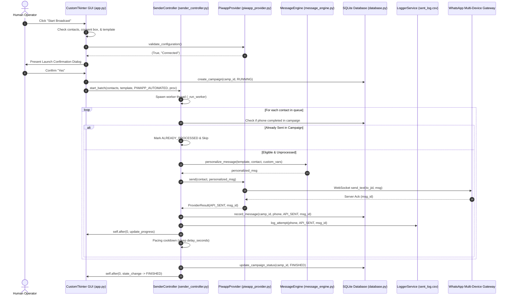

<div align="center">

# 💬 WhatsApp Bulk Messenger

**A compliant, privacy-first desktop messaging system built in Python & CustomTkinter with multi-device socket automation and manual browser verification.**

[](https://www.python.org/)
[](https://customtkinter.tomschimansky.com/)
[](#-testing)
[](https://github.com/n-92/piwapp)
[](#-data-storage--privacy)
[](#-requirements)

<br/>

> **⚠️ Compliance & Responsible Use Notice**  
> This application is strictly designed for communicating with **explicitly opted-in contacts** (customer service notifications, order confirmations, appointment reminders). Unsolicited bulk messaging or spamming violates WhatsApp’s Terms of Service and data protection regulations (GDPR, Moroccan Law 09-08). Unofficial multi-device socket clients are subject to protocol changes and server-side rate limits. Use conservative cooldown delays and verify recipient consent before broadcasting.

</div>

---

## 📑 Table of Contents

- [Overview](#-overview)
- [Key Features](#-key-features)
- [Application Preview](#-application-preview)
- [Technology Stack](#-technology-stack)
- [Architecture & Workflow](#-architecture--workflow)
- [Requirements](#-requirements)
- [Installation](#-installation)
- [Windows Standalone Executable (.exe)](#-windows-standalone-executable-exe)
- [Provider Setup & Authentication](#-provider-setup--authentication)
  - [1. piwapp Pure-Python Automation (Default)](#1-piwapp-pure-python-automation-default)
  - [2. WhatsApp Web Manual Review (Fallback)](#2-whatsapp-web-manual-review-fallback)
  - [3. Official WhatsApp Business Cloud API (Optional Backend)](#3-official-whatsapp-business-cloud-api-optional-backend)
- [Usage Guide](#-usage-guide)
- [Message Customization & Dynamic Variables](#-message-customization--dynamic-variables)
- [Data Storage & Privacy](#-data-storage--privacy)
- [Testing](#-testing)
- [Troubleshooting](#-troubleshooting)
- [Security & Compliance](#-security--compliance)
- [Roadmap](#-roadmap)
- [Contributing](#-contributing)
- [License](#-license)
- [Acknowledgments](#-acknowledgments)

---

## 🌟 Overview

**WhatsApp Bulk Messenger** is an open-source desktop workstation application for dispatching personalized, high-context business messages to authorized recipients. 

### Why WhatsApp Bulk Messenger?
Sending individual notifications to hundreds of customers via regular mobile interfaces is slow and error-prone. Traditional third-party extensions often scrape browser DOMs or hijack web sessions, leading to session crashes and account flags.

This application provides a structured, desktop-native approach:
- **Dual Delivery Strategy:** Offers pure-Python background automation via native WebSockets (`piwapp`), alongside a zero-dependency human-in-the-loop fallback using WhatsApp Web click-to-chat links.
- **Data Integrity & Validation:** Normalizes domestic and international phone numbers (with dedicated Moroccan dialing support), flags duplicates, and validates explicit opt-in consent from CSV inputs.
- **Dynamic Variable Injection:** Allows operators to compose rich message templates with automatic column substitution (`{name}`, `{product}`, `{price}`, `{city}`).
- **Local Persistence & Audit Trail:** Records all dispatches in SQLite with thread-safe append-only CSV audit logs and masked reporting to protect client privacy.

---

## ✨ Key Features

| Capability | Verified Feature Description | Status |
|---|---|:---:|
| 📂 **CSV Contact Ingestion** | Multi-encoding detection (`utf-8-sig`, `cp1256`, `latin-1`), automatic delimiter sniffing (`,`, `;`, `\t`, `\|`), and custom header mapping. | **Active** |
| 📞 **Phone Normalization** | Strict validation supporting Moroccan domestic prefixes (`05`, `06`, `07`, `+212`, `00212`) and full international E.164 formats (8 to 15 digits). | **Active** |
| 🛡️ **Opt-In & Suppression** | Automatic detection of opt-in consent columns (`yes`, `oui`, `1`, `true`) and cross-referencing against an SQLite `opt_outs` blacklist. | **Active** |
| ✏️ **Advanced Template Editor** | Multiline text composer with word wrap, emoji support, variable chip insertion, and real-time live preview for selected contacts. | **Active** |
| 🧩 **Dynamic Custom Variables** | Create custom variables (e.g., `{product}`, `{price}`) with optional fallback values and automatic matching against CSV data columns. | **Active** |
| ⚠️ **Missing Variable Alerts** | Real-time preview warnings flag missing recipient variables before messages are sent to prevent incomplete communications. | **Active** |
| 💾 **Persistent Template Store** | Save, load, duplicate (`Save As`), and delete templates backed by independent formatted JSON files in `data/templates/`. | **Active** |
| ⚡ **piwapp Direct Automation** | Native multi-device WebSocket client. Authenticates via QR code, performs Noise handshakes, and dispatches directly without a browser. | **Active** |
| 👁️ **Manual Review Fallback** | Opens prefilled WhatsApp Web chats in your default browser. Requires explicit human operator confirmation for each message. | **Active** |
| ⏱️ **Pacing & Queue Controls** | Configurable cooldown delays (3s to 60s), interruptible sleep loops, thread-safe pause, resume, and stop controls. | **Active** |
| 🎯 **Scoped Deduplication** | Campaign-scoped deduplication allows safe restarts without repeating recipients, plus optional global historical suppression. | **Active** |
| 📊 **Audit & Reporting** | Thread-safe logging to `sent_log.csv` and SQLite database tracking with privacy-compliant masked phone export (`21261****678`). | **Active** |

---

## 🖼️ Application Preview

```text
+-----------------------------------------------------------------------------------------------------+
| 💬 WhatsApp Bulk Messenger v1.0.0                      [Dark Theme Toggle] [ Opt-in Authorized ]    |
+---------------------------------------------------+-------------------------------------------------+
| 1. CONTACTS MANAGER                               | 2. MESSAGE CUSTOMIZATION                        |
| [ Total: 4 ] [ Valid: 4 ] [ Invalid: 0 ]          | Active Template: Product Offer (with Variables) |
| [ 📂 Import CSV ] [ Filter: All Contacts v ]      | [➕ New] [➕ Add Var] [💾 Save] [📂 Load] [🗑️ Del]  |
|                                                   | Insert variable: [{name}] [{phone}] [✨{product}] |
| #  Name        Phone           Status   Opt-in    | +---------------------------------------------+ |
| 1  Yassine     +212 612-345678 PENDING  Yes       | | [✏️ Template]  [👁️ Live Preview]             | |
| 2  Amine       +212 661-123456 PENDING  Yes       | | Bonjour {name},                             | |
| 3  Sara        +212 712-987654 PENDING  Yes       | | Votre commande {product} est prête!         | |
| 4  Karim       +212 522-001122 PENDING  Yes       | | Prix: {price} MAD.                          | |
|                                                   | +---------------------------------------------+ |
+---------------------------------------------------+-------------------------------------------------+
| 3. BROADCAST & PACING CONTROLS                    | 4. LIVE ACTIVITY LOG & AUDIT TRAIL              |
| STATUS: READY    Current: None                    | [📊 Open sent_log.csv] [🧹 Clear Console]       |
| Progress: 0 / 4 (0%) • 4 Remaining                |                                                 |
| [▶️ Start Broadcast] [⏸️ Pause] [⏯️ Resume] [⏹️ Stop] | 18:30:01 [INFO] Contacts loaded: 4 valid.       |
| Delivery Provider: [ piwapp (Automation - Default) v] 18:30:15 [INFO] piwapp: Active session connected. |
| [piwapp: Connected (+212600816547)] [🔗 Pair QR]  | 18:31:00 [INFO] Ready to broadcast.             |
| Cooldown Delay: [========O=======] 15 seconds     |                                                 |
| [X] I certify recipient consent (opt-in)          |                                                 |
+---------------------------------------------------+-------------------------------------------------+
```

> *Tip: Screenshots and visual walkthrough assets can be placed in `assets/screenshots/`.*

---

## 🛠️ Technology Stack

```text
┌────────────────────────────────────────────────────────────────────────┐
│                        PRESENTATION LAYER (GUI)                        │
│                 CustomTkinter 6.0.0 • Pillow 13.0.0                    │
└───────────────────────────────────┬────────────────────────────────────┘
                                    ▼
┌────────────────────────────────────────────────────────────────────────┐
│                      CONTROLLER & WORKFLOW ENGINE                      │
│                  SenderController • Python Threading                   │
└──────────────┬────────────────────┬────────────────────┬───────────────┘
               │                    │                    │
┌──────────────▼─────┐┌─────────────▼─────────┐┌─────────▼──────────────┐
│   BUSINESS LOGIC   ││   DELIVERY PROVIDERS  ││   PERSISTENCE LAYER    │
│ • ContactManager   ││ • PiwappProvider      ││ • SQLite 3 (WAL Mode)  │
│ • PhoneValidator   ││   (Pure-Python Socket)││ • LoggerService (CSV)  │
│ • MessageEngine    ││ • WebManualProvider   ││ • TemplateManager      │
│ • TemplateManager  ││   (Browser Click2Chat)││   (data/templates/*.json)│
│                    ││ • CloudApiProvider    ││ • piwapp Sessions      │
│                    ││   (Meta REST Backend) ││                        │
└────────────────────┘└───────────────────────┘└────────────────────────┘
```

| Layer | Component | Implementation |
|---|---|---|
| **User Interface** | Main Window & Widgets | `customtkinter`, `tkinter.ttk`, `darkdetect` |
| **Protocol / Socket** | Multi-Device WhatsApp Client | `piwapp`, `pydantic`, `cryptography`, `protobuf` |
| **Image Processing** | QR Code Generator | `qrcode`, `pillow` |
| **HTTP Transport** | REST Client & Adapters | `requests`, `urllib3` |
| **Database** | Relational Audit Store | `sqlite3` (WAL mode enabled for concurrency) |
| **File I/O** | Contacts & Logs | Native `csv` (`utf-8-sig` encoding with BOM) |
| **Quality Assurance**| Automated Test Suite | `unittest` (81 unit and integration tests) |

---

## 🏗️ Architecture & Workflow

The following sequence diagram outlines the verified execution flow during an automated broadcast dispatch:



---

## 📋 Requirements

- **Operating System:** Windows 10/11 (Recommended), Linux, or macOS.
- **Python Version:** Python `3.10` or newer (Tested on Python `3.15.0` 64-bit).
- **Network:** Active internet connection with outbound access to:
  - `wss://web.whatsapp.com/ws/chat` (Multi-device socket protocol)
  - `https://web.whatsapp.com/sw.js` (Dynamic protocol revision check)

---

## 🚀 Installation

### 1. Clone the Repository
```bash
git clone https://github.com/your-username/whatsapp-bulk-messenger.git
cd whatsapp-bulk-messenger
```

### 2. Set Up a Virtual Environment
```bash
# Windows (PowerShell / Command Prompt)
python -m venv venv
.\venv\Scripts\activate

# Linux / macOS
python3 -m venv venv
source venv/bin/activate
```

### 3. Install Dependencies
```bash
pip install --upgrade pip
pip install -r requirements.txt
```

### 4. Run the Application
```bash
python main.py
```

---

## 📦 Windows Standalone Executable (.exe)

You can package and distribute **WhatsApp Bulk Messenger** as a native, standalone Windows application that runs without requiring Python to be installed on target machines.

### 🛠️ One-Click Build Script

Run the automated Windows batch build script from the repository root:

```cmd
build_windows.bat
```

This automated script performs:
1. **Python Environment Verification:** Ensures Python 3.10+ is detected.
2. **PyInstaller Check:** Automatically installs or updates PyInstaller.
3. **Automated Test Suite:** Runs all 81 unit & integration tests before building to guarantee code integrity.
4. **Clean Binary Compilation:** Builds `dist\WhatsAppBulkMessenger\WhatsAppBulkMessenger.exe` using `WhatsAppBulkMessenger.spec`.

### ⚙️ Manual Build via PyInstaller Spec

If compiling manually from PowerShell or Command Prompt:

```cmd
python -m PyInstaller WhatsAppBulkMessenger.spec --noconfirm --clean
```

The output executable is generated at:
```text
dist\WhatsAppBulkMessenger\WhatsAppBulkMessenger.exe
```

### 📂 Per-User Data Directory (`%LOCALAPPDATA%`)

When running as a packaged standalone binary, application data is isolated to a writable per-user directory:
```text
%LOCALAPPDATA%\WhatsAppBulkMessenger\
├── whatsapp_messenger.db        # SQLite campaign and message database
├── sent_log.csv                 # Audit log of message delivery attempts
├── piwapp_session.json          # Multi-device pairing credentials
├── piwapp_session.json.keys     # Encryption keys & pre-keys
└── templates\                   # User-defined message templates (.json)
```

**Key Architectural Guarantees:**
- **Zero Data Loss:** On first launch, existing local database files, session keys, and custom templates are non-destructively migrated to `%LOCALAPPDATA%\WhatsAppBulkMessenger\`.
- **Privacy & Security:** Sensitive contact CSVs, active session credentials, and local databases are **never** bundled inside the distribution executable.
- **Fail-Safe Crash Reporting:** If a fatal startup error occurs, a native Windows alert dialog is displayed with a direct link to `%LOCALAPPDATA%\WhatsAppBulkMessenger\crash.log`.

---

## 🔐 Provider Setup & Authentication

The application supports two primary dispatch workflows configured directly within the GUI:

### 1. piwapp Pure-Python Automation (Default)
Direct unattended sending over WebSockets without opening web browsers:
1. Launch the application (`python main.py`).
2. In the **Broadcast & Pacing Controls** panel, ensure **Delivery Provider** is set to `piwapp (Experimental Automation - Default)`.
3. If not yet linked, the status will show `piwapp: Pairing Required`.
4. Click **`🔗 Connect / Pair QR`**.
5. Open WhatsApp on your primary phone:
   - Navigate to **Settings** $\rightarrow$ **Linked Devices** $\rightarrow$ **Link a Device**.
6. Point your phone’s camera at the QR code displayed in the dialog.
7. Once linked, the modal automatically closes, and the status updates to:
   ```text
   piwapp: Connected (+212XXXXXXXXX)
   ```
8. Session credentials are saved to `piwapp_session.json` and persist across restarts.

### 2. WhatsApp Web Manual Review (Fallback)
Human-in-the-loop review requiring no socket pairing or credentials:
1. Select `WhatsApp Web (Manual Review Fallback)` in the provider dropdown.
2. Ensure you are signed in to [WhatsApp Web](https://web.whatsapp.com/) in your default browser.
3. When broadcasting, the application opens each contact's chat with the prefilled message.
4. Review the conversation in your browser, press Send in WhatsApp Web, and click **`Confirm Sent & Next`** in the application.

### 3. Official WhatsApp Business Cloud API (Optional Backend)
For developers requiring official Meta Business Cloud API automation:
- Copy `.env.example` to `.env`:
  ```bash
  cp .env.example .env
  ```
- Configure your Meta system user access token and Phone Number ID:
  ```env
  WHATSAPP_API_TOKEN=EAAxxxxxxx...
  WHATSAPP_PHONE_NUMBER_ID=109xxxxxxxx
  ```
- The backend provider implementation resides in [`src/providers/cloud_api_provider.py`](src/providers/cloud_api_provider.py).

---

## 📖 Usage Guide

```text
Step 1: Import CSV ──> Step 2: Compose Template ──> Step 3: Link Account ──> Step 4: Dispatch
```

1. **Import Contacts:**
   - Click **`📂 Import CSV`** in the Contacts Manager panel.
   - Select a CSV containing recipient phone numbers (e.g., `sample_contacts.csv`).
   - The system validates Moroccan and international formats, filters duplicates, and displays verified counts in the summary cards.

2. **Select or Create a Template:**
   - Choose a preset from the template dropdown or click **`➕ New Template`**.
   - Type your text in the **Message Template** tab.

3. **Insert Dynamic Variables:**
   - Click built-in variable chips (`{name}`, `{phone}`, `{clean_phone}`) to insert them at the text cursor.
   - Click **`➕ Add Variable`** to define custom placeholders (e.g., `{product}`, `{price}`) with optional fallback values.
   - Click **`💾 Save Template`** to store your configuration for future campaigns.

4. **Review Live Preview:**
   - Switch to the **Live Preview** tab or click any recipient in the Contacts table.
   - The preview updates dynamically to display how the message renders for that specific contact.
   - Verify that no `⚠️ WARNING: Missing variable` notices are displayed.

5. **Configure Cooldown Pacing:**
   - Adjust the **Cooldown Delay** slider (recommended: 10 to 30 seconds for socket automation).

6. **Confirm Consent and Launch:**
   - Check the required **`[X] I certify recipient consent (opt-in)`** confirmation box.
   - Click **`▶️ Start Broadcast`**.
   - Review the launch summary dialog (provider, mode, contact count, pacing).
   - Click **`Confirm & Send`** to begin.

7. **Monitor and Control:**
   - Use **`⏸️ Pause`**, **`⏯️ Resume`**, or **`⏹️ Stop`** at any time.
   - View real-time dispatch progress in the **Live Activity Log**.
   - Click **`📊 Open sent_log.csv`** or **`📊 History & Audit`** to review outcomes.

---

## 💬 Message Customization & Dynamic Variables

Messages are interpolated dynamically per contact using the [`MessageEngine`](src/message_engine.py).

### Built-in Variables
- `{name}` / `{nom}`: Recipient's full name (falls back to `"Valued Customer"` if empty).
- `{phone}`: Formatted domestic phone number (e.g., `+212 612-345678`).
- `{clean_phone}`: Standard international clean digits without symbols (e.g., `212612345678`).
- `{formatted_phone}`: Clean international display string.

### Custom Variables & CSV Column Mapping
Any custom column in your CSV is automatically mapped to template placeholders.

#### Example CSV (`sample_contacts.csv`):
```csv
phone,name,city,product,price,opted_in
+212612345678,Yassine,Casablanca,Formation Python,500,yes
+212661123456,Sara,Rabat,Pack E-commerce,1200,yes
```

#### Example Template:
```text
Bonjour {name},

Votre commande pour {product} à {city} est validée.
Le montant total est de {price} MAD.

Bien cordialement,
L'équipe commerciale
```

#### Rendered Message (Contact 1):
```text
Bonjour Yassine,

Votre commande pour Formation Python à Casablanca est validée.
Le montant total est de 500 MAD.

Bien cordialement,
L'équipe commerciale
```

---

## 🔒 Data Storage & Privacy

All campaign data, logs, and authentication tokens are kept strictly on your local machine:

```text
whatsapp-bulk-messenger/
├── data/templates/*.json         # Saved message templates and custom variable schemas
├── whatsapp_messenger.db         # Local SQLite DB (Campaign records, message idempotency, opt-outs)
├── sent_log.csv                  # Chronological audit log with UTF-8 BOM encoding
├── piwapp_session.json           # Local WhatsApp companion auth keys (Ignored by git)
├── piwapp_session.json.keys      # Cryptographic Signal double-ratchet pre-keys (Ignored by git)
└── piwapp_version.json           # Cached WhatsApp Web client revision
```

### Sensitive Files & Security Best Practices
- **Session Credentials:** `piwapp_session.json` and `*.keys` contain active cryptographic session keys linked to your WhatsApp account. **Never commit, share, or upload these files.** Both are excluded in `.gitignore`.
- **Privacy Masking:** The application provides an audit export feature via [`DatabaseManager.export_campaign_csv()`](src/database.py) that masks recipient phone numbers (`21261****678`) to protect customer data during compliance reviews.

---

## 🧪 Testing

The repository includes a comprehensive regression test suite built on `unittest`. All tests run locally without making real network dispatches or modifying persistent databases.

### Run Full Test Suite
```bash
python -m unittest discover tests
```

### Verified Test Results
```text
Ran 81 tests in 6.462s

OK (0 failures, 0 errors, 0 skipped)
```

### Test Suite Structure
- [`tests/test_validator.py`](tests/test_validator.py): 12 tests covering Moroccan dialing formats (`05`, `06`, `07`, `+212`, `00212`), missing zeros, and international E.164 rules.
- [`tests/test_contact_manager.py`](tests/test_contact_manager.py): 6 tests covering CSV parsing, delimiter sniffing, opt-in consent parsing, and duplicate rejection.
- [`tests/test_message_engine.py`](tests/test_message_engine.py): 8 tests covering multilingual interpolation, custom variable defaults, CSV overrides, and emoji handling.
- [`tests/test_template_manager.py`](tests/test_template_manager.py): 8 tests covering JSON template persistence, overwrite protection, and corrupted storage tolerance.
- [`tests/test_database.py`](tests/test_database.py): 4 tests covering SQLite campaign operations, message idempotency, and masked audit exports.
- [`tests/test_logger_service.py`](tests/test_logger_service.py): 2 tests covering concurrent CSV logging and already-sent deduplication sets.
- [`tests/test_sender_controller.py`](tests/test_sender_controller.py): 3 tests covering controller states, consent enforcement, and manual review pacing.
- [`tests/test_automated_dispatch.py`](tests/test_automated_dispatch.py): 6 tests covering unattended automation, resume deduplication, and failure recovery.
- [`tests/test_cloud_api_provider.py`](tests/test_cloud_api_provider.py): 9 tests covering official Meta Cloud API payload generation and REST error handling.
- [`tests/test_piwapp_provider.py`](tests/test_piwapp_provider.py): 11 tests covering QR pairing lifecycle, protocol revision fetching, and socket timeouts.
- [`tests/test_campaign_deduplication.py`](tests/test_campaign_deduplication.py): 6 tests covering campaign-scoping versus global deduplication and provider routing.
- [`tests/test_ui_layout.py`](tests/test_ui_layout.py): 6 tests covering responsive layout geometry and minimum screen boundaries.

---

## ❓ Troubleshooting

### 1. WhatsApp Connection Closes with Error 405 (`logged_out=False`)
- **Cause:** Meta occasionally deprecates older WhatsApp Web client revisions.
- **Solution:** The application includes an automated version scraper in [`src/providers/piwapp_provider.py`](src/providers/piwapp_provider.py) that queries `https://web.whatsapp.com/sw.js` and caches the live revision in `piwapp_version.json`. If 405 occurs, the cache is invalidated automatically. Click **`Disconnect`**, wait 5 seconds, and click **`🔗 Connect / Pair QR`** to re-authenticate with the latest version.

### 2. Contacts Are Skipped as "Already Sent"
- **Cause:** The campaign deduplication system detected that these phone numbers were completed previously.
- **Solution:** Click **`✨ New Campaign`** in the control panel to start a fresh batch. If you want to resend to numbers logged in previous historical runs, ensure the **`Global History Deduplication`** checkbox is unchecked.

### 3. Contact Shows `No Consent` Status
- **Cause:** The CSV row does not have an opt-in column or the value is empty/false.
- **Solution:** Include an `opted_in` column in your CSV with values such as `yes`, `oui`, `1`, or `true`.

### 4. Template Preview Shows `⚠️ WARNING: Missing variable`
- **Cause:** The template references a variable (e.g., `{appointment}`) that does not exist in the contact's CSV row and has no default fallback value.
- **Solution:** Click **`➕ Add Variable`** and define a default fallback value, or add the missing column to your CSV file.

---

## 🛡️ Security & Responsible Use

1. **Explicit Recipient Consent:** Always obtain documented opt-in consent before dispatching WhatsApp messages.
2. **Opt-Out Compliance:** Respect recipient opt-out requests immediately. Add suppressed numbers to the suppression list or remove them from marketing datasets.
3. **Pacing & Frequency:** Use conservative cooldown intervals (15 to 30 seconds per message) to prevent automated anti-abuse flagging by WhatsApp servers.
4. **Never Commit Secrets:** Do not commit `.env`, `piwapp_session.json`, or SQLite databases to public repositories.

---

## 🗺️ Roadmap

- [x] Responsive CustomTkinter desktop interface.
- [x] Moroccan domestic and international E.164 phone validation.
- [x] WhatsApp Web click-to-chat manual review provider.
- [x] Pure-Python `piwapp` multi-device WebSocket automation.
- [x] Persistent JSON template manager with custom variables.
- [x] Scoped campaign deduplication and SQLite idempotency store.
- [ ] In-app visual suppression / opt-out list editor.
- [ ] User settings persistence (`settings.json` for theme and default pacing).
- [ ] One-click CSV export of filtered contact tables from GUI.
- [ ] Scheduled campaign dispatches with background timers.

---

## 🤝 Contributing

Contributions are welcome! Please follow these steps:

1. **Fork the Repository** on GitHub.
2. **Create a Feature Branch**:
   ```bash
   git checkout -b feature/your-feature-name
   ```
3. **Run the Test Suite** to ensure no regressions:
   ```bash
   python -m unittest discover tests
   ```
4. **Commit Your Changes** with clear commit messages:
   ```bash
   git commit -m "feat: add support for contact table csv export"
   ```
5. **Push to Your Branch**:
   ```bash
   git push origin feature/your-feature-name
   ```
6. **Open a Pull Request** describing your improvements.

---

## 📄 License

The license for this repository has not yet been specified. All rights remain reserved by the project author until an open-source license (such as MIT or Apache 2.0) is officially published.

---

## 👥 Acknowledgments

- Built with [CustomTkinter](https://github.com/TomSchimansky/CustomTkinter) by Tom Schimansky.
- WebSocket multi-device protocol implementation powered by [piwapp](https://github.com/n-92/piwapp).
- Official WhatsApp Cloud API documentation provided by [Meta for Developers](https://developers.facebook.com/).
